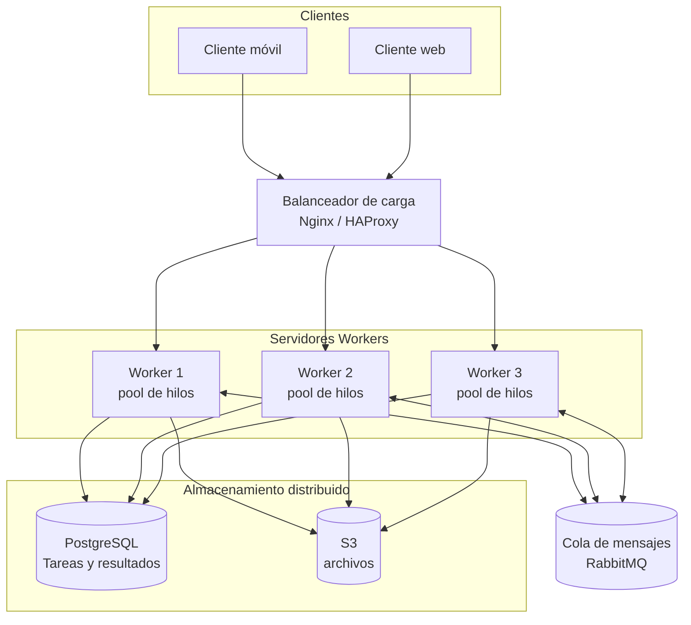
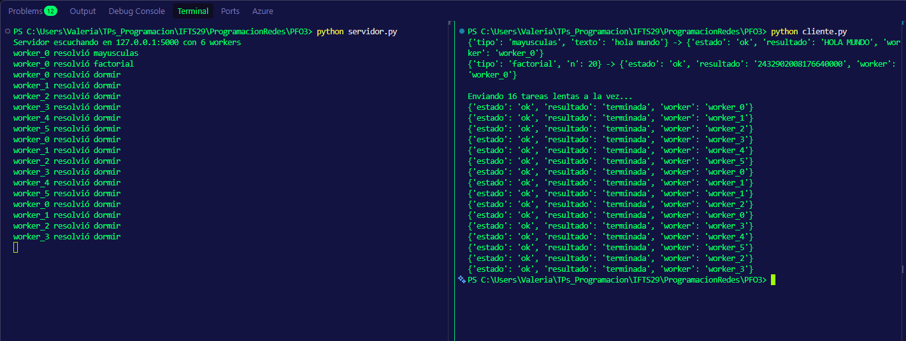

# PFO 3: Rediseño como Sistema Distribuido (Cliente-Servidor)

## Enunciado

### *Objetivo:* Transformar el sistema en una arquitectura distribuida usando sockets

### *Consignas:*

1. Diseña un diagrama que incluya:
   - Clientes (móviles, web).
   - Balanceador de carga (Nginx/HAProxy).
   - Servidores workers (cada uno con su pool de hilos).
   - Cola de mensajes (RabbitMQ) para comunicación entre servidores.
   - Almacenamiento distribuido (PostgreSQL, S3).

2. Implementa en Python:
    - Un servidor que reciba tareas por socket y las distribuya a workers.
    - Un cliente que envíe tareas y reciba resultados.

### *Entregables:*

### Código del servidor y cliente en repositorio de Github

[Repositorio](https://github.com/Irinath/IFTS29_PsR_2c2026_VThomas_PFO3)

### Diagrama del sistema
  


#### Componentes

| Componente | Rol |
|---|---|
| Clientes (móvil / web) | Envían tareas y reciben resultados por socket TCP. |
| Balanceador (Nginx / HAProxy) | Reparte las conexiones entre los servidores (round-robin o least-conn). |
| Workers con pool de hilos | Procesan tareas en paralelo; cada servidor tiene N hilos. |
| RabbitMQ | Cola de mensajes para que los servidores se pasen tareas y eventos de forma desacoplada. |
| PostgreSQL | Persistencia de tareas, estados y resultados. |
| S3 | Almacenamiento de archivos grandes (entradas/salidas de tareas). |

### Implementación

La implementación en Python reproduce el núcleo del diagrama en un solo proceso:

- `servidor.py`: socket TCP que acepta varios clientes (un hilo por conexión). Cada tarea recibida se delega con `pool.submit()` a un `ThreadPoolExecutor` de 6 hilos workers, y el resultado se devuelve al cliente por el mismo socket.
- `cliente.py`: abre una conexión por tarea, envía la tarea en JSON y espera el resultado. Para probar la concurrencia lanza 16 tareas lentas en paralelo, lo que muestra cómo los 6 workers se reparten el trabajo.

El `ThreadPoolExecutor` y su cola interna cumplen localmente el papel que RabbitMQ cumple en el sistema completo: desacoplan a quien recibe la tarea de quien la ejecuta.

---
*Decisiones de diseño:*

- Una _tarea por conexión_: es más simple que mantener la conexión abierta, y el paralelismo lo logra el cliente abriendo varias conexiones a la vez.
- Un _timeout de 30 segundos_: si se vence, el cliente recibe un error, pero el worker sigue ejecutando la tarea hasta terminarla. Es una limitación real que RabbitMQ con confirmaciones (acks) resolvería mejor.
  
#### Cómo ejecutarlo

Requiere Python 3.10+, sin dependencias externas.

```bash
# Terminal 1: servidor con 6 workers
python servidor.py
# Terminal 2: lote de tareas de ejemplo
python cliente.py
```

Abrí varios clientes a la vez para ver cómo los workers se reparten el trabajo (el log del servidor muestra qué hilo resolvió cada tarea).

#### Captura de pantalla con las pruebas Cliente-Servidor


