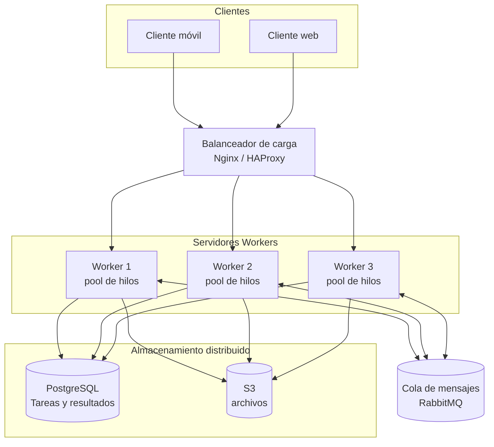

# PFO 3: Rediseño como Sistema Distribuido (Cliente-Servidor)

## Enunciado

### *Objetivo:* Transformar el sistema en una arquitectura distribuida usando sockets

### *Consignas:*

1. Diseña un diagrama que incluya:
   - Clientes (móviles, web).
   - Balanceador de carga (Nginx/HAProxy).
   - Servidores workers (cada uno con su pool de hilos).
   - Cola de mensajes (RabbitMQ) para comunicación entre servidores.
   - Almacenamiento distribuido (PostgreSQL, S3).

2. Implementa en Python:
    - Un servidor que reciba tareas por socket y las distribuya a workers.
    - Un cliente que envíe tareas y reciba resultados.

### *Entregables:*

## Diagrama del sistema
  


- Código del servidor y cliente en repositorio de Github.

#### Componentes

| Componente | Rol |
|---|---|
| Clientes (móvil / web) | Envían tareas y reciben resultados por socket TCP. |
| Balanceador (Nginx / HAProxy) | Reparte las conexiones entre los servidores (round-robin o least-conn). |
| Workers con pool de hilos | Procesan tareas en paralelo; cada servidor tiene N hilos. |
| RabbitMQ | Cola de mensajes para que los servidores se pasen tareas y eventos de forma desacoplada. |
| PostgreSQL | Persistencia de tareas, estados y resultados. |
| S3 | Almacenamiento de archivos grandes (entradas/salidas de tareas). |

### Implementación

La implementación en Python reproduce el núcleo del diagrama en un solo proceso:

- `servidor.py`: socket TCP que acepta varios clientes (un hilo por conexión), mete cada tarea en una `queue.Queue` y un pool de hilos workers las resuelve y devuelve el resultado al cliente correcto.
- `cliente.py`: se conecta, envía tareas en JSON y recibe los resultados en un hilo aparte (no bloquea esperando cada respuesta).

La `queue.Queue` cumple localmente el papel que RabbitMQ cumple en el sistema completo.

#### Cómo ejecutarlo

Requiere Python 3.10+, sin dependencias externas.

```bash
# Terminal 1: servidor con 6 workers
python servidor.py
# Terminal 2: lote de tareas de ejemplo
python cliente.py
```

Abrí varios clientes a la vez para ver cómo los workers se reparten el trabajo (el log del servidor muestra qué hilo resolvió cada tarea).

#### Captura de pantalla con las pruebas Cliente-Servidor


